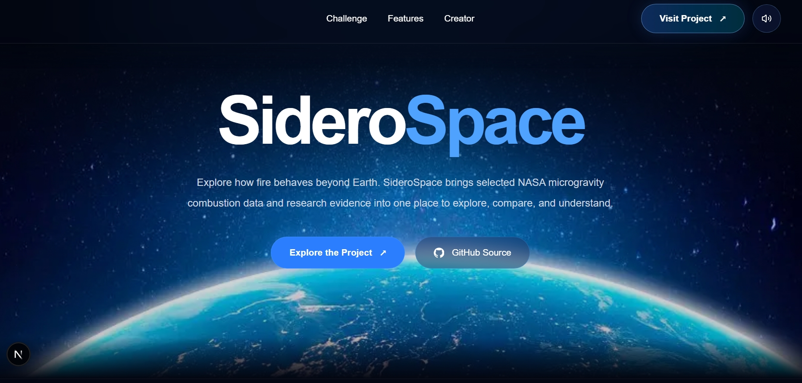
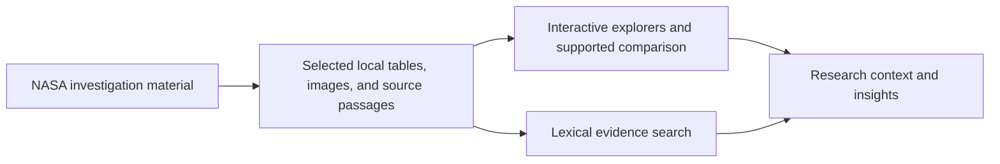

<div align="center">

<p align="center">
  
</p>

[](https://nextjs.org/)
[](https://react.dev/)
[](https://www.typescriptlang.org/)
[](https://www.spaceappschallenge.org/)

[Explore the repository](https://github.com/adimail/SideroSpace) · [Features](docs/FEATURES.md) · [Data & evidence](docs/DATA_AND_EVIDENCE.md) · [Demo guide](docs/DEMO_GUIDE.md)

# SideroSpace

### Understanding Fire Beyond Earth.

An interactive research platform for exploring selected NASA microgravity-combustion data, imagery, and source evidence in one place.

</div>

---

## About

Combustion in microgravity does not behave exactly as it does on Earth: gravity-driven buoyancy and airflow change how heat and gases move around a flame. Understanding those differences matters when studying fire behavior and designing for crewed spacecraft, where reliable evidence is essential.

**SideroSpace brings selected material from three spaceflight combustion investigations into an accessible workspace.** Explore the local experiment records and image sequence, compare supported measurements, and follow research questions to indexed source passages—while keeping each dataset's coverage and limitations visible.

The project was developed for the **NASA Space Apps Challenge 2026** challenge **“Flames in Freefall.”** It is an independent project, not a NASA product.

## What you can explore

<table>
  <tr>
    <td width="50%" valign="top">
      <strong>Investigation explorers</strong><br />
      Inspect FLEX and BASS-II records, filters, charts, data-quality notes, and filtered CSV exports. Browse SAFFIRE-I frames with timestamps and image metadata.<br />
      <code>/flex</code> · <code>/bass-ii</code> · <code>/saffire</code>
    </td>
    <td width="50%" valign="top">
      <strong>Supported comparisons</strong><br />
      Select FLEX and BASS-II records and compare only explicitly configured compatible measurements. Initial oxygen is the currently declared common comparison.<br />
      <code>/compare</code>
    </td>
  </tr>
  <tr>
    <td width="50%" valign="top">
      <strong>Research Library</strong><br />
      Search a local index of source passages and inspect available investigation, source, page, and chunk details. Retrieval is lexical, not semantic.<br />
      <code>/research</code>
    </td>
    <td width="50%" valign="top">
      <strong>Ask &amp; Insights</strong><br />
      Review curated question-and-answer entries or retrieve passages for a free-text query. Explore authored findings, conclusions, potential applications, and research gaps.<br />
      <code>/ask</code> · <code>/insights</code>
    </td>
  </tr>
</table>

The project landing page is at `/`; the research dashboard is at `/dashboard`. Run the app locally to explore these routes.

## Investigations and integrated material

The counts below describe **selected local files in this repository**, not the complete NASA archives.

| Investigation | What it contributes here | Current local coverage |
|---|---|---|
| **FLEX** — Flame Extinguishment Experiment (PSI-69) | Droplet-combustion records, filters, charts, and data-quality context | 274 CSV records |
| **BASS-II** — Burning and Suppression of Solids (PSI-25) | Solid-fuel experiment records and available gas readings/metadata | 129 CSV records |
| **SAFFIRE-I** — Spacecraft Fire Experiment (PSI-98) | Navigable F1C1 image sequence with frame and timestamp metadata | 764 pre-test flow-visualization JPEGs; no integrated numeric fire-measurement table |
| **Indexed research evidence** | Searchable passages associated with the three investigations | 352 passages: 276 FLEX, 44 BASS-II, 32 SAFFIRE-I |

For source handling, coverage details, units, and known gaps, see [Data &amp; Evidence](docs/DATA_AND_EVIDENCE.md).

## How it works



The passage index is generated from available source material; it is not a complete archive. Search returns ranked passages, and free-text Ask queries do not generate answers.

## Technology

| Layer | Technologies used |
|---|---|
| Application | Next.js 16 App Router, React 19, TypeScript |
| Styling | Tailwind CSS 4 and route/component CSS |
| Data and charts | Papa Parse for CSV parsing; Recharts for charts |
| Interface icons | Lucide React |

## Get started

**Requirements:** Node.js and npm. No application environment variables are required.

```bash
git clone https://github.com/adimail/SideroSpace.git
cd SideroSpace
npm install
npm run dev
```

Open [http://localhost:3000](http://localhost:3000). Available project checks:

```bash
npm test
npx tsc --noEmit
npm run lint
npm run build
```

See [Getting Started](docs/GETTING_STARTED.md) for prerequisites, troubleshooting, and script details.

## Project map

```text
src/app/          App Router pages and research-search API route
src/components/   Dashboard, investigation explorers, shared and landing UI
src/lib/          Data parsing, comparison, research content and retrieval
public/data/      Selected CSVs, evidence index, SAFFIRE-I manifest and images
scripts/          Evidence-index generation and SAFFIRE inventory audit
docs/             Architecture, feature, data, design, demo and setup guides
```

### Documentation

- [Features & route inventory](docs/FEATURES.md)
- [Architecture & data flow](docs/ARCHITECTURE.md)
- [Data, evidence & limitations](docs/DATA_AND_EVIDENCE.md)
- [Getting started](docs/GETTING_STARTED.md)
- [Demo guide](docs/DEMO_GUIDE.md)
- [Design notes](docs/DESIGN.md)
- [Roadmap](docs/ROADMAP.md)

## Scientific integrity and limitations

- **Independent project:** SideroSpace is not affiliated with, endorsed by, or an official product of NASA or the NASA Space Apps Challenge.
- **Different kinds of material:** CSV values and image frames are experimental records; indexed passages are extracted research text; dashboard and Insights content is authored interpretation. Do not treat these as interchangeable evidence.
- **Bounded coverage:** the local files represent selected available material, not complete investigation archives. SAFFIRE-I coverage here is pre-test imagery, not quantitative fire measurements.
- **Search scope:** Library and free-text Ask use lexical passage retrieval. They do not perform semantic investigation ranking or generate answers.
- **Comparison scope:** only the measurement explicitly configured as common is offered across FLEX and BASS-II. Similar labels alone do not prove comparable protocols or conditions.
- **No safety certification:** interpretations and potential applications are research context, not validated spacecraft procedures, safety thresholds, or engineering recommendations.

More detail is documented in [Data &amp; Evidence](docs/DATA_AND_EVIDENCE.md) and [Architecture](docs/ARCHITECTURE.md).

## Creator & acknowledgements

Created independently by **Muhammad Yahya**, computer science student and software engineer, for the NASA Space Apps Challenge 2026 challenge **“Flames in Freefall.”**

We acknowledge NASA and the NASA Space Apps Challenge as the sources of the investigation context and challenge prompt. Their mention does not imply review, sponsorship, or endorsement of SideroSpace.

---

<div align="center">
  <sub>Built to make selected microgravity-combustion research easier to explore—and easier to question.</sub>
</div>
