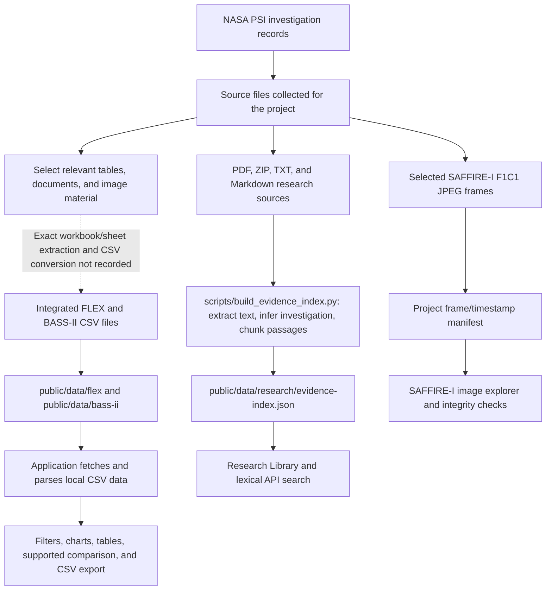

# SideroSpace Data Processing and Integration Methodology

This document describes the data files and processing steps that can be
verified in the repository. It distinguishes NASA PSI source material from
SideroSpace integration files and calculated display values.

The repository does **not** contain a download log, source-file checksums, or a
CSV-conversion script. Consequently, the exact source workbook, worksheet,
table-extraction procedure, and conversion settings used to produce the two
integrated CSVs are undocumented. Those details are identified as unverified
below rather than inferred.

## 1. Original data sources

The project identifies NASA's [Physical Sciences Informatics (PSI)
repository](https://psi.nasa.gov/physci/repo) as the source for the selected
investigations. The direct PSI investigation records referenced by the
application are:

| Investigation | PSI identifier | PSI investigation record |
|---|---|---|
| FLEX - Flame Extinguishment Experiment | PSI-69 | [NASA PSI record](https://psi.nasa.gov/physci/repo/data/investigations/PSI-69) |
| BASS-II - Burning and Suppression of Solids-II | PSI-25 | [NASA PSI record](https://psi.nasa.gov/physci/repo/data/investigations/PSI-25) |
| SAFFIRE-I - Spacecraft Fire Safety Experiment-I | PSI-98 | [NASA PSI record](https://psi.nasa.gov/physci/repo/data/investigations/PSI-98) |

Depending on an investigation, PSI source material can include tabular files,
workbooks, reports, image sequences, metadata, or archives. The files
currently checked into SideroSpace are not a complete record of everything
that may have been downloaded. No acquisition date, PSI file version, source
checksum, or complete download manifest is tracked.

## 2. Source files and project integration files

The following inventory describes the files present in the repository. A file
being present locally does not by itself establish its exact download date or
that it is byte-for-byte identical to a PSI-hosted file.

| Repository path | Format and role | Status |
|---|---|---|
| `public/data/flex/flex.csv` | CSV table; 274 data records and 15 columns used by FLEX | Integrated application input. The FLEX page names the source as `PSI-69_Experimental table_FLEX.csv`, but that named source file is not checked in. Whether the local CSV was downloaded as CSV or exported from another format is undocumented. |
| `public/data/bass-ii/bass-ii.csv` | UTF-8 CSV table; 129 data records and 17 columns used by BASS-II | Integrated application input. The original source filename and any workbook/worksheet used to make it are not recorded in the repository. |
| `public/data/research/PSI-25_metadata_PSI_metadata_PSI-101_BASS-II.zip` | ZIP archive containing PSI metadata files | Supporting source material; not the BASS-II experiment table consumed by the explorer. |
| `public/data/research/PSI-98_metadata_PSI-166_SAFFIRE-I.zip` | ZIP archive containing PSI metadata files | Supporting source material; not the local SAFFIRE-I image sequence. |
| `public/data/research/SAFFIRE-I Operations.pdf` | PDF | Supporting SAFFIRE-I operational reference. |
| `public/data/research/SAFFIRE-I Image Directory Nomenclature.pdf` | PDF | Supporting reference for image-directory and filename terminology. |
| `public/data/saffire/f1c1/*.jpeg` | 764 JPEG images | Local F1C1 pre-test flow-visualization sequence. The image archive's original download filename and acquisition details are not tracked. |
| `public/data/saffire/f1c1/manifest.json` | JSON frame manifest | Project integration file mapping frame numbers and filenames to timestamps. No manifest-generation script is included. |
| `public/data/research/evidence-index.json` | JSON passage index | Generated project output; not an original NASA source file. |
| `public/data/saffire/f1c1/integrity-report.json` | JSON audit report | Generated project output; not an original NASA source file. |

The evidence index also refers to source names including
`FLEX_EIRD_v4.pdf`, `FLEX_Test_Plan.pdf`,
`PSI-69_metadata_PSI-133_FLEX.zip`, `FLEX-007_DropletData.txt`, and
`FLEX-008_TestSheet.txt`. These files are not present in the checked-in
`public/data/research/` directory. The index builder can read files from
user-specific `Downloads/SAFFIRE`, `Downloads/FLEX`, and `Downloads/BASS`
directories, but the repository does not record the original paths for those
indexed inputs. Their exact acquisition and retention history therefore
cannot be reconstructed from this checkout.

There is no Excel workbook in the repository. The workbook name expected by
the SAFFIRE inventory scripts is
`SAFFIRE-1_MergeResult-jpeg_Update_Final_v2.xlsx`; it is expected in the
user's `Downloads/SAFFIRE` directory and is not an input to FLEX/BASS-II CSV
conversion.

## 3. Extraction and CSV preparation

### What is implemented

The web application consumes the two checked-in CSV files directly; no
application code converts a NASA workbook into either CSV. The repository
contains no script that reads a FLEX or BASS-II Excel workbook, selects a
worksheet, extracts a table, or writes these CSV files.

Accordingly, the exact original table/worksheet names, the method used to
select rows and columns, and whether conversion was done with Excel, another
tool, or a pre-existing PSI CSV are **not documented or verifiable here**.
The files below should be described as the selected integrated CSV
representations, not as evidence that SideroSpace independently measured or
generated the experiment data.

### Runtime CSV handling

- FLEX is fetched from `/data/flex/flex.csv`. The page decodes its bytes with
  the `windows-1252` encoding in `src/lib/csv-encoding.ts`, then parses the
  header row with Papa Parse. The file has 274 non-empty data records.
- BASS-II is fetched from `/data/bass-ii/bass-ii.csv` and parsed with Papa
  Parse. The checked-in file is UTF-8 with a byte-order mark; comparison code
  explicitly decodes it as UTF-8. The file has 129 data records.
- The parsers skip empty rows and keep record fields as strings until a chart
  or calculation needs a number. The comparison utilities normalize headers
  for field lookup; they do not rewrite the stored source CSV headers.
- Blank or nonnumeric values are not imputed. Numeric charts omit values that
  cannot be parsed; BASS-II initial/final scatter plots require both values
  in a pair. A zero is retained as a value and is flagged for review where
  applicable.
- FLEX and comparison exports contain the currently filtered source records.
  FLEX and Compare write UTF-8 CSV with a byte-order mark. Exporting is not a
  conversion of the full original NASA source archive.

### Calculated and normalized display values

| Value shown | Processing performed | Interpretation |
|---|---|---|
| FLEX initial oxygen in Compare | FLEX source value (mole fraction) multiplied by 100; BASS-II calibrated initial oxygen is read in its recorded `% by vol` scale | The resulting display is percent. This is the one field currently declared comparable across the two tables; it does not establish equivalent test protocols. |
| Dashboard distributions | Numeric values are grouped into descriptive histogram bins; missing/nonnumeric values are excluded | Bin counts are summaries of the integrated records, not additional measurements. |
| BASS-II material counts | Whitespace is trimmed and repeated whitespace is collapsed when grouping labels | This is used for display counts; it does not establish that different labels are scientifically distinct materials or that matching labels are equivalent samples. |
| Filtered charts and tables | Filters select records; source values remain available in the table/export | Filtering does not change the original CSV files. |

The FLEX field `Burning rate; mm` is retained under its source header. The
header alone does not establish a physical definition beyond the stated `mm`;
SideroSpace does not convert it to another unit.

## 4. Investigation-specific processing

### FLEX - PSI-69

**Source and selection.** The application links to the PSI-69 record and
identifies the table as `PSI-69_Experimental table_FLEX.csv`. That named
original file is not in this checkout, and no workbook, worksheet, extraction
script, conversion log, or row-level source mapping is available to verify how
the 274-row `public/data/flex/flex.csv` was produced.

**Integrated data.** The CSV contains 15 columns:

`FLEX Test #`, `FLEX Identifier`, `Test Date`, `Test GMT`, `Fuel`,
`Ambient pressure; mmHg`, `O initial ambient composition; mole fraction`,
`N initial ambient composition; mole fraction`,
`CO initial ambient composition; mole fraction`,
`He initial ambient composition; mole fraction`,
`Droplet initial diameter; mm`,
`Visible flame extinction diameter; mm`, `Burning rate; mm`,
`Burn time; s`, and `Test end`.

These are droplet-combustion records and associated measurements/labels.
Application code uses the recorded identifiers, fuel, pressure, composition,
diameter, burn time, and test-end fields. It flags missing measurements,
selected zero/high values, and repeated identifiers for review; it does not
silently replace those values.

**Website use.** `/flex` supports record search and filters, charts, a
paginated table, data-quality notes, and filtered CSV export. `/compare` also
reads the table. The dashboard reads selected FLEX columns for descriptive
summaries.

**Limitations.** The table is a selected integration, not the complete FLEX
archive. The original source version and conversion lineage are not tracked.
The physical definition/unit of `Burning rate; mm` is not established by the
header alone. A displayed relationship is descriptive and does not establish
causation.

### BASS-II - PSI-25

**Source and selection.** The application links to the PSI-25 record and
includes the PSI metadata archive
`public/data/research/PSI-25_metadata_PSI_metadata_PSI-101_BASS-II.zip`.
The original experiment-table filename, workbook, worksheet, and
CSV-conversion procedure are not present or documented.

**Integrated data.** `public/data/bass-ii/bass-ii.csv` contains 129 records and
17 columns:

`PI`, `Test #`, `Date`, `GMT`, `Sample #`, `Fuel Sample Material`,
`Flow restrictor`, `Fan display`, `Air display`,
`Radiometer gain   (1000   250   50   10)`, `Total Frames Shot`,
`Calibrated  initial O2 % by vol `, `Calibrated final O2 % by vol`,
`Initial CO2 % by vol`, `Final CO2 % by vol`, `Initial CO (ppm)`, and
`Final CO (ppm)`.

The initial-oxygen header has a trailing space in the CSV. The `/bass-ii`
explorer uses the exact header, while Compare trims and collapses whitespace
for column lookup without changing the CSV key.

The integrated table therefore provides sample/material and experiment
metadata plus gas-composition readings. It does **not** contain direct
flame-spread-rate or ignition-time measurements in these columns.

**Website use.** `/bass-ii` provides text/material filtering, three
initial-versus-final gas plots (O2, CO2, and CO), a paginated table, missing
pair counts, and filtered CSV export. The plots use only records with both
numeric readings. Compare can display BASS-II fields individually; only
initial oxygen is configured for cross-investigation comparison.

**Limitations.** Some equipment/display headers do not define units or exact
physical meaning by themselves. A change between initial and final gas
readings is descriptive and is not, on its own, a measurement of flame spread,
ignition, or a causal mechanism.

### SAFFIRE-I - PSI-98

**Source and selection.** The application links to the PSI-98 record. The
repository retains the PSI-98 metadata ZIP and the two SAFFIRE-I reference
PDFs listed above. It also contains 764 local F1C1 JPEG frames and a
project-side manifest. The exact original image archive name, download
version, and manifest-generation procedure are not recorded.

**Integrated data.** `public/data/saffire/f1c1/manifest.json` maps each frame
number to its JPEG filename, millisecond timestamp, and UTC timestamp. The
local sequence is **pre-test flow-visualization imagery**. It is not the
sample-burning footage and does not provide numerical flame-spread or
heat-release measurements.

**Website use.** `/saffire` loads the JPEG named by the manifest, displays
frame/time metadata, supports frame seeking and playback, and allows the
current image to be downloaded. No image-processing or scientific-measurement
extraction step is implemented in the application.

**Limitations.** The image sequence is a limited camera/phase selection, not
the complete SAFFIRE-I archive. A frame's filename or timestamp is not a
flame measurement. Experiment findings quoted elsewhere in the application
must be traced to their technical source, not attributed to these pre-test
frames.

## 5. Integration into SideroSpace

| Asset | Application path and behavior |
|---|---|
| FLEX CSV | `src/app/flex/page.tsx` fetches `/data/flex/flex.csv`; `src/lib/csv-encoding.ts` decodes it; Papa Parse reads records for filters, charts, tables, and exports. `src/lib/dashboard-analytics.ts` also reads the file for dashboard summaries. |
| BASS-II CSV | `src/app/bass-ii/page.tsx` fetches `/data/bass-ii/bass-ii.csv`; `src/app/compare/page.tsx` loads it with FLEX for comparison. Charts and tables use selected raw fields; CSV export uses filtered records. |
| SAFFIRE frames | `src/components/saffire/SaffireExplorer.tsx` reads `/data/saffire/f1c1/manifest.json` and displays the matching JPEGs under `/data/saffire/f1c1/`. |
| Research sources | `src/app/research/page.tsx` loads `public/data/research/evidence-index.json` in the browser and ranks passages locally. Its source catalog also links to the PSI investigation pages and selected local PDFs. |
| API evidence search | `src/app/api/research/search/route.ts` reads the same evidence index on the server and calls `src/lib/research-retrieval.ts`. Ask and dashboard discovery use this API. Search is lexical; it does not generate answers. |
| Investigation descriptions/references | `src/lib/experiment-research-content.ts` contains authored investigation descriptions, field notes, caveats, and source links. These are application content, not CSV columns. |

The evidence index records a passage ID, inferred investigation ID,
source filename/type, optional PDF page, chunk number, and extracted text.
It does not contain a verified URL or checksum for every source. For some
results, the interface links to an investigation-level PSI record rather than
the exact original file/page. Treat the filename, page, and experiment
classification as navigation aids that may require source-level verification.

## 6. Data integrity and traceability

### Checks implemented in the repository

- The FLEX explorer calculates missing-value counts, checks repeated
  identifiers, and flags zero pressure, zero extinction diameter, and
  pressure values above 1,500 mmHg for review. These checks do not modify or
  delete source values.
- Dashboard analytics checks for required FLEX/BASS-II columns and confirms
  that the evidence-index passage count matches its summary count.
- Compare validates expected columns and rejects ambiguous normalized headers.
  Its focused tests cover FLEX/BASS-II initial-oxygen mapping and unsupported
  cross-dataset comparisons.
- The BASS-II page counts complete initial/final pairs for oxygen, carbon
  dioxide, and carbon monoxide. Missing or nonnumeric values are not
  synthesized.
- The current SAFFIRE manifest contains 764 unique image filenames, and the
  checked-in image directory contains 764 JPEGs. A filename comparison during
  this review (2026-11-13) found all manifest entries present and no extra
  JPEGs.
- `scripts/audit_saffire.py` can compare the manifest and image directory with
  the `PreFlowVis - TimeSort` worksheet in a user-supplied workbook. It checks
  filenames, sizes, duplicate inventory names, and basic JPEG start/end
  markers. These markers are not a full image decode or scientific
  validation.
- `scripts/build_evidence_index.py` reports extraction errors and writes
  extracted-text limitations into its output. It does not validate scientific
  claims or guarantee that inferred experiment labels are correct.

### Traceability gaps and caveats

- There is no tracked FLEX/BASS-II table-conversion script, source workbook,
  source checksum, download manifest, or record-by-record lineage file.
- The FLEX page states that its CSV matched a downloaded NASA reference across
  274 rows with zero field-level differences. The reference file and
  comparison procedure are not included, so this assertion cannot be
  reproduced from the repository alone.
- The checked-in SAFFIRE integrity report's `local_directory` field points to
  a different project checkout. The report should be regenerated from this
  repository and its required source workbook before its inventory comparison
  is treated as current.
- The checked-in evidence index is dated `2026-10-18`. Its summary reports 6
  PDFs, 9 ZIP archives, and 14 text files scanned, but not all those source
  files are checked into this repository. Rebuilding the same index requires
  the original inputs and Python `pypdf` dependency.
- No checksums or archive/version identifiers connect each indexed passage or
  CSV row to a specific PSI download. Original record identifiers are
  retained in the tables, but they are not a complete source-file lineage
  mechanism.

The evidence-index builder is separate from the FLEX/BASS-II CSV integration.
It recursively scans `public/data/research` and the configured
`Downloads/SAFFIRE`, `Downloads/FLEX`, and `Downloads/BASS` directories. It
extracts PDF text page by page with `pypdf`, reads `.txt`/`.md` files and those
file types inside ZIP archives (with a 5 MB per-member limit), normalizes
whitespace, and writes passages of up to 1,200 characters with a configured
180-character overlap. Near the end of a chunk, it prefers newline, period-
space, or semicolon-space boundaries when one is past the halfway point.
Investigation IDs are inferred from filenames and text patterns. The output
retains the source name/type, optional PDF page, chunk number, and text; it
does not parse workbook/CSV/image contents, perform OCR, verify the inferred
investigation, or validate the scientific claims in a passage. The index's
`ZIP metadata` and `Text metadata` labels describe the ingestion path, not a
guarantee that every passage is metadata or equivalent scientific prose.

### Recommended future improvements (not currently implemented)

1. Keep a source manifest with PSI record URL, original filename, retrieval
   date/version, checksum, and license/usage notes.
2. Track the original tables or a reproducible extraction script and record
   workbook/sheet/table selection and any conversion parameters.
3. Generate a row-level or file-level lineage report linking integrated files
   to their exact source assets.
4. Regenerate the SAFFIRE integrity report from the current checkout and
   record the workbook version/checksum used for the inventory comparison.
5. Add source/page links for quantitative Insights claims and identify whether
   each value is reported by a publication, read from an integrated table, or
   calculated by the application.

## 7. Data processing workflow

The table-extraction/conversion step for FLEX and BASS-II is not represented
by a tracked script. Dashed connectors mark that undocumented step; the
diagram does not assert which software or workbook procedure was used.

## 8. Scientific and technical notes

- NASA PSI is the source repository identified for the selected investigation
  records. SideroSpace is an independent research-exploration project, not an
  official NASA product or NASA-endorsed platform.
- The CSV files are the project-integrated representations of selected
  records. CSV conversion or presentation does not mean SideroSpace
  independently generated or experimentally measured those values.
- Source headers and values should remain unchanged unless a transformation
  is necessary and documented. The current cross-investigation oxygen
  comparison multiplies FLEX's mole-fraction value by 100 and uses the
  recorded BASS-II `% by vol` value; this display normalization does not
  establish protocol equivalence.
- Record counts describe the files in this repository, not the complete FLEX,
  BASS-II, or SAFFIRE-I archives and not the full NASA PSI repository.
- BASS-II gas-composition fields are not direct flame-spread or ignition
  measurements. The integrated SAFFIRE-I F1C1 images are pre-test
  flow-visualization frames, not sample-burning footage.
- Indexed passages, experiment-table values, image metadata, and authored
  findings are different evidence types. A retrieved passage is not an
  independently verified conclusion; a chart or comparison is not a
  spacecraft safety prediction or certified recommendation.

For current coverage, units, and search limitations, see
[Data and Evidence](./DATA_AND_EVIDENCE.md). For application routes and data
flow, see [Architecture](./ARCHITECTURE.md).
